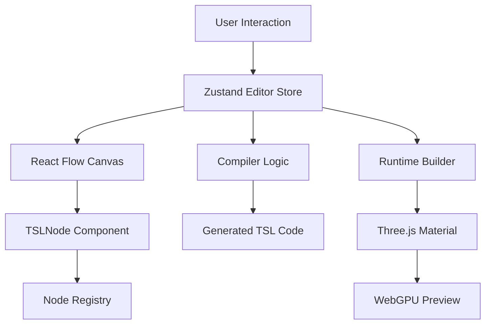

# TSL Editor

## Project Overview
This project is a **visual node-based editor for Three.js Shading Language (TSL)**. It allows users to create shader materials visually by connecting nodes, similar to Blender's Shader Editor or Unreal Engine's Material Editor.

The application has two main outputs:
1.  **Generated Code**: It produces valid JavaScript/TSL code that can be used in a Three.js project (displayed in `CodePanel`).
2.  **Live Preview**: It renders a 3D preview of the material using `three/webgpu` (displayed in `Preview`).

## Tech Stack
*   **Framework**: Next.js 16 (App Router)
*   **UI Library**: React 19
*   **Styling**: Tailwind CSS
*   **State Management**: Zustand
*   **Node Graph Engine**: React Flow (`@xyflow/react`)
*   **3D Engine**: Three.js (`three`, specifically valid for WebGPU environment)
*   **Icons**: Lucide React
*   **Syntax Highlighting**: Prism React Renderer

## Architecture & Data Flow



## Detailed Feature Implementation

### 1. Node Graph Editing
*   **Implementation**: Built on top of `ReactFlow` in `components/Editor.tsx`.
*   **State**: Managed by `store/editor.ts` (Zustand). It tracks `nodes`, `edges`, and `selection`.
*   **Custom Nodes**: All nodes utilize a single generic component `components/TSLNode.tsx`.
    *   This component looks up the node definition in `lib/registry.ts` using `data.type`.
    *   It dynamically renders input/output handles (`TSLHandle.tsx`) based on the definition.
    *   It handles inline renaming via double-click on the header.
*   **Cycle Detection**: Before any connection is made, `isValidConnection` in `Editor.tsx` calls `hasCycle` (`lib/graph-utils.ts`) to prevent infinite loops in the shader graph.

### 2. Node Library & Picker
*   **Registry**: The source of truth for all nodes is `lib/registry.ts`. It maps unique strings (e.g., `math/add`) to definitions (inputs, outputs, TSL function mappings).
*   **Discovery**: `initializeNodes()` in `lib/nodes/index.ts` populates this registry on app launch.
*   **Picker UI**: `components/NodePicker.tsx` iterates through the registry (grouped by category) and provides buttons to add nodes.
*   **Placement**: When adding a node, it calculates the center of the viewport using `screenToFlowPosition` and adds a random offset to prevent stacking.

### 3. Properties Panel (Reactivity)
*   **Purpose**: Allows editing values (numbers, colors, vectors) for inputs that are *not* connected to other nodes.
*   **Implementation**: `components/PropertiesPanel.tsx`.
*   **Selection Tracking**: It listens to `selectedNodeId` from the store.
*   **Filtering**: It filters out inputs that are already connected, so you can't manually edit a value that is being driven by another node.
*   **Optimized Rendering**:
    *   Uses specialized sub-components (`ColorInput`, `VectorInput`).
    *   **Debouncing**: User input is debounced (delayed) using `useDebouncedCallback` so that we don't trigger a full graph re-render/re-compile on every keystroke.

### 4. Code Generation (Compiler)
*   **Core Logic**: Located in `lib/compiler.ts`.
*   **Topological Sort**: The graph is first sorted (`topologicalSort`) so that dependencies are declared before they are used.
*   **Variable Naming**:
    *   Generates variable names like `add_1`, `vec3_2`.
    *   Uses the node's `localName` if the user renamed it (sanitized to be a valid var name).
*   **Swizzling**:
    *   The compiler automatically handles vector component access.
    *   If an edge connects Key `x` of Node A to Node B, the compiler appends `.x` to the variable name (e.g., `nodeA.x`).
    *   Logic: `getInputValue` checks `edge.sourceHandle` against a map of swizzles (`x`, `y`, `z`, `w`, `r`, `g`, `b`).

### 5. Live 3D Preview (WebGPU)
*   **Component**: `components/Preview.tsx`.
*   **Engine**: Uses `three/webgpu` (WebGPURenderer) for modern shader support.
*   **Runtime Building**:
    *   Unlike the *text* compiler, the *runtime* builder (`lib/tsl-builder.ts`) executes the actual TSL functions in JavaScript.
    *   `import { add } from 'three/tsl'` -> `const result = add(nodeA, nodeB);`
    *   This builds a real `NodeMaterial` object (e.g., `MeshStandardNodeMaterial`).
*   **Error Handling**: If the graph is invalid, the builder throws an error, which is caught and displayed in the UI overlay.

## Directory Structure & Key Files

### `/lib` (Core Logic)
*   **`registry.ts`**: Central database of node definitions.
*   **`compiler.ts`**: Converts graph -> String Code.
*   **`tsl-builder.ts`**: Converts graph -> Three.js Material (Runtime).
*   **`graph-utils.ts`**: Algorithms (Topological Sort, Cycle Detection).

### `/components` (UI)
*   **`Editor.tsx`**: Main canvas wrapper.
*   **`TSLNode.tsx`**: The visualization of a node.
*   **`PropertiesPanel.tsx`**: Side panel for editing values.
*   **`CodePanel.tsx`**: Modal for viewing generated code.
*   **`Preview.tsx`**: The 3D viewport.

## Key Interfaces (`lib/types.ts`)
```typescript
export interface TSLNodeData extends Record<string, unknown> {
    type: NodeType;               // e.g., 'math/add'
    values: Record<string, any>; // User-edited values (e.g. { a: 0.5 })
    localName?: string;          // User-defined custom name
}
```
## Data Structure Examples

### 1. Node Object (Runtime Data)
This is the structure of a node as it exists in the React Flow state (`useEditorStore`).

```json
{
  "id": "1",
  "type": "math/add",
  "position": { "x": 100, "y": 200 },
  "data": {
    "type": "math/add",
    "localName": "MyAdder",
    "values": {
      "a": 1.5,        // User manually entered 1.5 for input 'a'
      "b": 0           // 'b' might be connected, so this value is ignored
    },
    // Tracks which handles have edges connected to them
    "connected": {
      "b": true,
      "out": true
    }
  }
}
```

### 2. Node Definition (Registry entry)
This is the static definition found in `lib/registry.ts`, defining how a node behaves and looks.

```json
{
  "type": "math/add",
  "label": "Add",
  "category": "Math",
  "tsl": "add",        // Maps to `import { add } from 'three/tsl'`
  "inputs": {
    "a": {
      "label": "A",
      "type": "any",
      "default": 0
    },
    "b": {
        "label": "B",
        "type": "any",
        "default": 0
    }
  },
  "outputs": {
    "out": {
        "label": "Out",
        "type": "any"
    }
  }
}
```

## Setup & Running
1.  `npm install`
2.  `npm run dev` (Starts at `http://localhost:3000`)
3.  `npm run test` (Runs Vitest for logic verification)

## Contributing

Contributions are welcome! Please feel free to submit a Pull Request.

## License

This project is licensed under the MIT License - see the [LICENSE](LICENSE) file for details.
